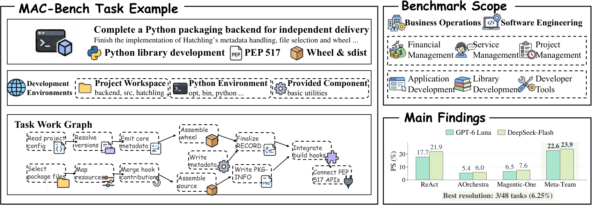

---
language:
- en
license: mit
size_categories:
- n<1K
tags:
- benchmark
- agents
- multi-agent
- tool-use
- software-engineering
pretty_name: MAC-Bench
configs:
- config_name: default
  data_files:
  - split: dev
    path: data/dev.parquet
  - split: test
    path: data/test.parquet
---

<h1 align="center">MAC-Bench</h1>
<p align="center"><strong>Benchmarking Multi-Agent Collaboration via Interconnected Tasks</strong></p>
<p align="center">
💻 <a href="https://github.com/rzchen777-wq/MAC_Bench">Code</a> &nbsp;·&nbsp;
🧩 <a href="#tasks">Tasks</a> &nbsp;·&nbsp;
🚀 <a href="#download-and-run">Download & Run</a> &nbsp;·&nbsp;
📂 <a href="#dataset-files">Dataset Files</a> &nbsp;·&nbsp;
📊 <a href="#evaluation">Evaluation</a>
</p>
<p align="center">


</p>

MAC-Bench evaluates multi-agent collaboration through **interconnected tasks** in **business operations** and **software engineering**. Task components exchange outputs or share resources, so their results need to fit together. The evaluated system chooses its agents, divides the work and coordinates their actions.

<p align="center"></p>

## 🧩 Tasks

Each category contains **eight test tasks and one development task**.

| Domain | Category | Test | Development |
| --- | --- | ---: | ---: |
| Business operations | Finance | 8 | 1 |
| Business operations | Service administration | 8 | 1 |
| Business operations | Project and content operations | 8 | 1 |
| Software engineering | Applications | 8 | 1 |
| Software engineering | Libraries | 8 | 1 |
| Software engineering | Developer tools | 8 | 1 |
| **Total** | **6 categories** | **48** | **6** |

### 🏫 Prepare the autumn preschool intake

Reconcile applications, reserve suitable places and arrange family inductions across six centres. Signed evidence, programme capacities, family availability and officer records determine the arrangements. Siblings must attend the same centre; each induction must match the placements and an appropriately qualified officer's schedule. The final reservations, appointments and handover records are checked together.

**Task ID:** `op26_service_administration_007` · **Split:** development

### 📦 Complete the release packaging backend

Implement Flit's metadata handling, source selection, wheels, source archives and build interfaces. The initial workspace includes API declarations, documentation, supporting components and public tests. A source archive must rebuild into an installable wheel; evaluation checks the resulting packages in a fresh consumer environment.

**Task ID:** `flit_packages` · **Split:** development

The Dataset Viewer above contains the complete task descriptions. To browse them in Python:

```python
from datasets import load_dataset

tasks = load_dataset("sihuichuibuqi/MAC-Bench", split="test", revision="v1.0")
print(tasks[0]["instruction"])
```

## 🚀 Download and run

Clone the [evaluation code](https://github.com/rzchen777-wq/MAC_Bench), install the client and download one task:

```bash
git clone https://github.com/rzchen777-wq/MAC_Bench.git
cd MAC_Bench
pip install -e '.[modal,agents]'
mac-bench data download --task-id op26_service_administration_007
mac-bench tasks show op26_service_administration_007
```

The client downloads the selected task package and its required application images. Shared image layers are reused across tasks. Downloads run in parallel and reuse files already present locally; public access requires no token.

```bash
mac-bench data download --split dev    # Six development tasks
mac-bench data download --split test   # 48 test tasks
mac-bench data download                # All tasks
```

Each download uses a single dataset commit. The client verifies task packages and environment files before use, and records the resolved revision under `.cache/dataset/release.json`. To choose a release explicitly, add `--revision v1.0`.

### Download a package directly

The Hub client can also retrieve a task archive without installing the evaluator:

```python
from huggingface_hub import hf_hub_download

archive = hf_hub_download(
    repo_id="sihuichuibuqi/MAC-Bench",
    repo_type="dataset",
    revision="v1.0",
    filename="packages/flit_packages.tar.gz",
)
```

Software task packages include their workspace, environment recipe and verifier. Business task packages also require the OCI files listed in their `environment_assets` entry in `downloads.json`; `mac-bench data download` fetches these automatically.

## 📂 Dataset files

```text
README.md                       Dataset card
LICENSE / NOTICE                Licensing and third-party notices
data/
  dev.parquet                   Six development task descriptions
  test.parquet                  48 test task descriptions
tasks.json                      Task catalog and revisions
public_tasks.json               Task descriptions in JSON
downloads.json                  Package checksums and environment dependencies
packages/
  <task_id>.tar.gz               One runnable task package per task
environments/images/
  index.json / oci-layout        OCI image metadata
  blobs/sha256/                 Shared application layers and image descriptors
assets/overview.png             Benchmark overview
```

The viewer tables contain `task_id`, `domain`, `category`, `split`, `instruction`, `world_revision` and `package`. Task archives unpack to `manifest.json`, `public/` materials, environment resources and private evaluation files. Here, `private/` identifies evaluator-only files: the task loader exposes public materials and permitted operations to the agent.

Business environments use Twenty, Pretix, HRMS and BigCapital. Initial records and configuration are packaged with each task; common application layers are stored once in the OCI directory. Software tasks provide starter workspaces and dependency recipes. Modal prepares and caches task environments while each episode receives independent task state.

## 📊 Evaluation

**Progress Score (PS)** measures satisfied task goals. **Resolution Rate (RR)** measures complete task success. Outcomes are checked through application records and software artifacts. Agent roles, communication and work allocation are chosen by the evaluated system.

After configuring Modal and a model endpoint, a development episode can be run with:

```bash
mac-bench evaluate \
  --task-id op26_service_administration_007 \
  --method react_single --repetitions 1 \
  --max-tokens 1000000 --max-model-calls 80 \
  --max-tool-calls 160 --max-seconds 2400 \
  --out outputs/preschool-react
```

These are example run limits. Evaluation outputs include scores, tool interactions, model calls and token usage. Follow the [getting-started guide](https://github.com/rzchen777-wq/MAC_Bench/blob/main/docs/getting-started.md) for Modal and model setup, or the [agent integration guide](https://github.com/rzchen777-wq/MAC_Bench/blob/main/docs/agents.md) to evaluate your own system.

## License

MAC-Bench's original task specifications and code are released under the MIT License. Application images and software project assets retain their upstream licenses and notices; see `NOTICE` and the notices packaged with those assets.
