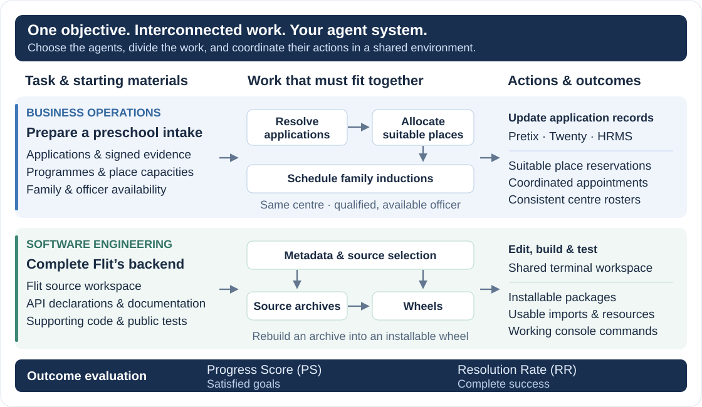

# Tasks

[Home](../README.md) · [Getting started](getting-started.md) · **Tasks** · [Evaluation](evaluation.md) · [Agent integration](agents.md) · [Environments](environments.md)

MAC-Bench tasks combine work components whose outputs or resource requirements interact. The system receives an objective, initial resources and tools; it chooses how to divide and coordinate the work. Completion is checked against the resulting application records or software artifacts.

## Categories and splits

| Domain | Category | Category ID | Test | Development |
| --- | --- | --- | ---: | ---: |
| Business operations | Finance | `business_finance` | 8 | 1 |
| Business operations | Service administration | `service_administration` | 8 | 1 |
| Business operations | Project and content operations | `project_content_operations` | 8 | 1 |
| Software engineering | Applications | `product_application` | 8 | 1 |
| Software engineering | Libraries | `platform_data` | 8 | 1 |
| Software engineering | Developer tools | `developer_release` | 8 | 1 |
| **Total** | | | **48** | **6** |

Use development tasks for integration and tuning, then fix system settings before test evaluation. Browse task descriptions with `mac-bench tasks list --split dev` and `mac-bench tasks show TASK_ID`, or run [examples/browse_tasks.py](../examples/browse_tasks.py).

## Example tasks

<p align="center">

</p>

### Prepare the autumn preschool intake

**Task ID:** `op26_service_administration_007` · **Split:** development

Six centres need consistent admissions records and family appointments. The system must resolve duplicate or outdated applications, allocate suitable places, and schedule inductions with qualified officers. Placement choices determine the receiving centre; family availability and officer duties constrain the corresponding appointment.

The task supplies signed business evidence and guides for recording outcomes. Its application records include place reservations in Pretix, notes and calendars in Twenty, and qualifications and duties in HRMS. Checks cover eligibility, suitable placement, coordinated appointments and the final handover.

<details>
<summary><strong>Full task instructions</strong></summary>

Prepare the autumn preschool intake

You work for Brookfield Public Preschool Admissions Office. Six centres need their autumn intake ready, but duplicate applications, decided appeals, withdrawals and unresolved residence evidence have left the provisional roster out of date. Existing place reservations and family appointments may therefore be for the wrong child or programme. Today is 2 August 2027. Complete preparation by 20 August. Appointment times are UTC.

There are 136 application entries for 120 children. The signed evidence supports ninety-six places from eighty-four families; twelve children lack current residence evidence and twelve have withdrawn. A child's place must fit guardian consent, age at term opening and access needs. Siblings need the same centre, although they may need different age-band programmes.

Each eligible family also needs one induction at its receiving centre, with siblings together. The guardian and all placed children must attend that appointment, and the admissions officer must meet the family's language and access-support needs. Place choices, family availability and officer schedules must therefore agree before the centre can receive a usable roster.

Task materials

Use public/materials.json to find the original business evidence by subject or business reference. It links to commission, workforce, centre-and-programme and family dossiers in public/business_materials.md and their Twenty notes. They connect existing evidence; all original source notes remain present and protected.

Twenty notes titled BPPA SOURCE ... contain signed applications, evidence, appeals, programme details and family contacts. Pretix holds free place reservations; Twenty holds induction calendars; HRMS holds officers' qualifications, leave and duties. Use public/records.json and the identity maps to locate records. Full admissions conditions and seven register formats are in public/business_policy.md and public/recording.md.

Required outcomes

- Resolve each child's application using the signed identity, current residence evidence, consent and decided appeals. Correct duplicate handling and retain the supported placement, evidence-deferral or withdrawal outcome, without changing source evidence to make the allocation easier.
- Confirm a suitable free programme place for every eligible child, matching age, guardian choices and access needs. Keep siblings at the same centre while respecting their different age bands, programme capacities and accessible-place limits. Retain compatible Pretix reservations and correct or cancel duplicate, obsolete and wrong-programme holds; deferred or withdrawn children keep no place.
- Arrange one accepted family induction at the receiving centre, with the actual guardian and all placed siblings together. Use an officer with the required language and access-support qualifications, create a visible calendar and submit a matching HRMS duty. Respect centre capacity, travel between centres, leave and existing work rather than creating an extra deferral or waiting list.
- Leave each child with a clear outcome and each centre with a usable incoming roster. Connect placed children to their actual reservation and family induction, and remove those arrangements for deferred or withdrawn children. The records prepare future admission; they do not assert attendance or require fees, payments or refunds.

Make the required changes in the applications and complete the handover under the policy and recording guides. Preserve original evidence and unrelated records. Keep future activities recorded as arrangements rather than completed work. You may organize the work freely.

</details>

### Complete the release packaging backend

**Task ID:** `flit_packages` · **Split:** development

The system implements the Flit 3.12.0 packaging backend in a source workspace. Metadata, file selection, wheel construction, source distributions and build hooks must agree. For example, a source archive must retain the inputs needed to rebuild an installable wheel.

Supporting parsers, API declarations, documentation and public tests are provided. Checks exercise packages in a fresh offline consumer environment, including imports, resources and console commands.

<details>
<summary><strong>Full task instructions</strong></summary>

Complete the release packaging backend

Implement the missing release backend in Flit 3.12.0. Application developers
need this backend to turn Python projects into distributable wheels and source
archives, then install and run those deliverables in environments that do not
contain the builder or project checkout. This is the complete flit_core subsystem,
with five responsibilities rather than a single packaging example.

1. Configuration and metadata: read supported legacy and PEP621 pyproject
   metadata; validate options, names, versions, dependencies, optional groups,
   authors, readmes, licenses and entry points. Inspect modules for dynamic
   version/description metadata and handle unsupported or malformed inputs.
2. Source and resources: locate modules/packages in root and src layouts,
   preserve resources, select package files and external data, and honor source
   archive include/exclude patterns without omitting crucial rebuild inputs.
3. Wheels: write installable wheel contents, tags, metadata, license resources,
   entry points and complete RECORD hashes/sizes. Honor normalized permissions
   and SOURCE_DATE_EPOCH reproducibility, preserving binary resources.
4. Source distributions: construct correct tar archives with PKG-INFO and source
   metadata, include the files required to rebuild, and exclude configured files.
   Rebuilding the resulting archive must produce a usable wheel.
5. Build interfaces: expose PEP517/660 requirements, metadata preparation,
   wheel/sdist and editable build hooks; preserve their documented behavior.
   Installable results must support imports, resources and console commands.

TOML parsing, SPDX license data, version normalization and the frontend CLI
are provided. Public APIs, declarations, docstrings and original tests remain.
Choose your own implementation; grading checks artifacts in a fresh offline
consumer with neither flit_core nor the source workspace, not source identity.
Version normalization and configuration exception declarations must remain usable.

Workspace: /work/project. Python: /opt/engineering/bin/python.
Set PYTHONPATH=/work/project/flit_core. Public checks:
/opt/engineering/bin/python -m pytest -q flit_core/tests_core/

</details>

## What the system receives

| | Business operations | Software engineering |
| --- | --- | --- |
| Starting resources | Business evidence, policies and existing application records | Starter code, documentation and public fixtures |
| Interaction | Discover application operations, query records and make updates | Read and edit files, execute commands and run public checks |
| Shared environment | One set of application records for the team | One persistent workspace for the team |
| Evaluated outcome | Final records, relationships and required handover artifacts | Implementation behavior and produced artifacts |

`mac-bench evaluate --task-id TASK_ID --inspect` displays the actual instruction, environment usage guidance and tool schemas. This reads local task metadata and does not start a sandbox.

Private outcome verifiers and reference materials are available to benchmark maintainers in the dataset but are excluded from the agent interface. [Agent integration](agents.md) explains which context to pass to your system.

## Data layout

The lightweight indexes are included in the code checkout. Task resources and shared environment images come from the dataset archive.

```text
data/
├── tasks.json                   # IDs, splits, categories and task paths
├── public_tasks.json            # Browsable task instructions
├── tasks/<task_id>/
│   ├── manifest.json            # Identity, environment metadata and checksums
│   ├── public/                  # Instructions and solver materials
│   ├── private/                 # Outcome checks and reference materials
│   └── environment/             # Business service configuration and initial data
└── environments/images/         # Shared application images
```

The task folders are ordinary files. To check an installed task against the release checksums, use `mac-bench data verify --task-id TASK_ID`. [Getting started](getting-started.md#2-load-the-task-data) covers archive installation and selective downloads.

## Scores

**Progress Score (PS)** is the fraction of task goal conditions satisfied. **Resolution Rate (RR)** is the fraction of episodes that satisfy all requirements. An individual episode has RR equal to 0 or 1. Both metrics are stored on a 0–1 scale and can be displayed as percentages.

Scores depend on the final environment state and artifacts. Read [Evaluation](evaluation.md#read-results) for aggregation, run status and recorded checks.
